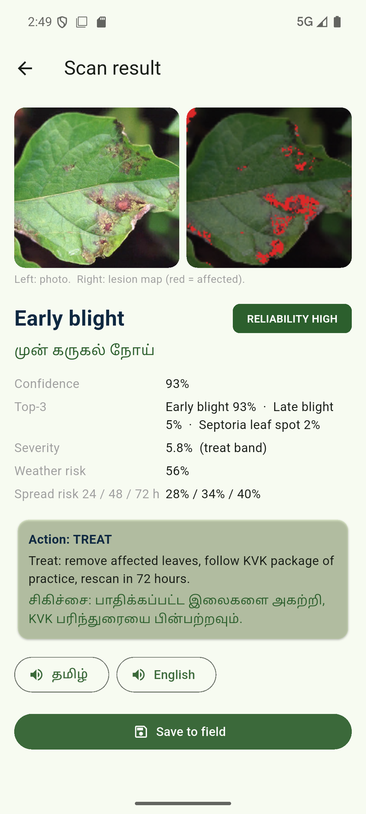
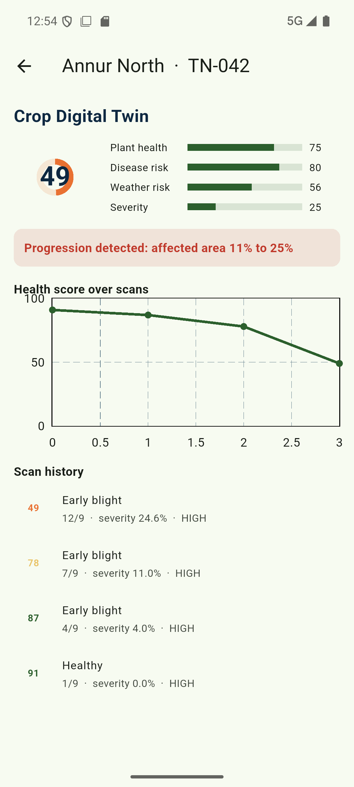
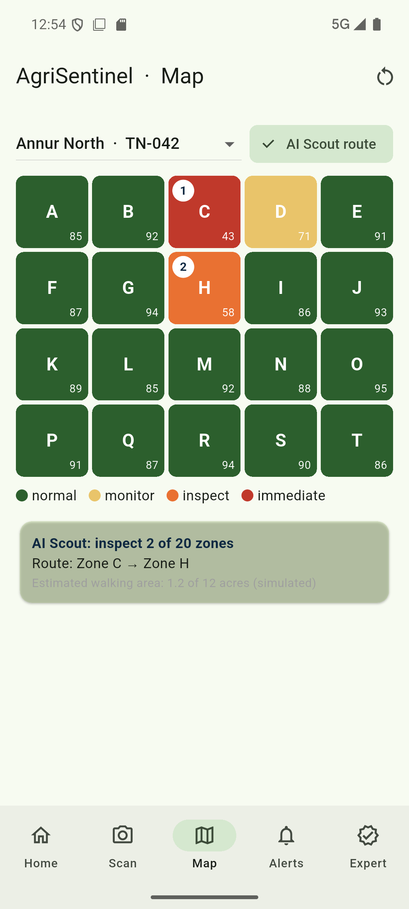
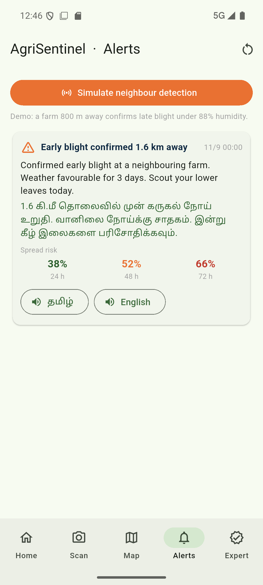
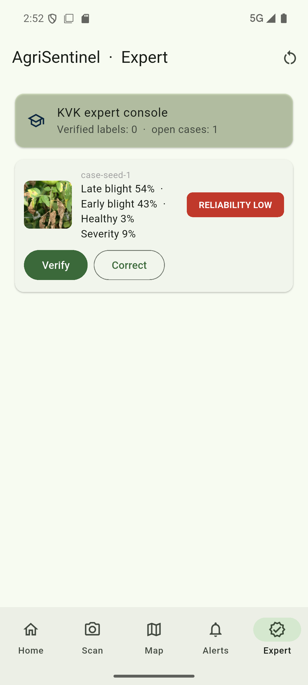

# AgriSentinel demo app

Demo for SDG NGP AI INNOVATE 2026, problem A1. No backend, no network; all logic runs locally on seeded data and pixel heuristics.

## Screenshots
<table>
  <tr>
    <td align="center"> Scan result + lesion map</td>
    <td align="center"> Crop digital twin</td>
    <td align="center"> Zone map + AI Scout</td>
    <td align="center"> Spread-risk alerts</td>
    <td align="center"> Expert console</td>
  </tr>
</table>

## Download
Get the Android APK from the [latest release](../../releases/latest). Most phones need `app-arm64-v8a-release.apk`; use `armeabi-v7a` for older 32-bit phones and `x86_64` for emulators. Allow "install unknown apps" when prompted.

## Run from source
- Windows: `flutter run -d windows` (needs Developer Mode enabled for plugin symlinks)
- Android: `flutter build apk --release --split-per-abi` then install `build/app/outputs/flutter-apk/app-arm64-v8a-release.apk`
- Tests: `flutter test`

## 30-minute review script
1. Home: two fields, Annur North worsening (78), Thondamuthur improving (84).
2. Scan > early_blight: Early blight, 93% confidence, severity 5.8% (treat band), RELIABILITY HIGH, lesion map, action TREAT, Tamil speak.
3. Scan > ambiguous: RELIABILITY LOW, top-2 within 9 points, expert line.
4. Scan > not_a_leaf: UNKNOWN ANOMALY.
5. From the early blight result tap Save to field: Home score drops, field page shows "Progression detected".
6. Map: Zone C red (immediate), Zone H orange (inspect); toggle AI Scout route; "inspect 2 of 20 zones".
7. Alerts: Simulate neighbour detection; alert with 24/48/72 h spread risk; speak in Tamil.
8. Expert: Verify the ambiguous case; counter goes to 1.
9. Select Thondamuthur, Scan > healthy, Save: field page shows "Recovery".
10. Reset icon in the app bar restores the seed.

## What is real and what is seeded
Real: pixel-based leaf segmentation (dark pixels count as lesion only when enclosed by plant tissue, so soil and shadow are not scored as disease), lesion percent, blur quality, colour-rule disease guess, all scoring rules, spread forecast, priority ranking, trend detection.
Seeded: field history, zone health values, weather, the first alert and expert case.
Not included: CNN model, backend, drone stitching, SMS.

## Notes
- Bundled sample photos come from the PlantDoc dataset (CC BY 4.0); `not_a_leaf.jpg` is generated. See `assets/samples/SOURCES.md`.
- Scanning a bundled sample uses its known label; a gallery photo is classified by colour rules, and a blurry photo drops to RELIABILITY LOW.
- Tamil speech needs a Tamil TTS voice. Android (Google TTS) has one; Windows is usually silent.
